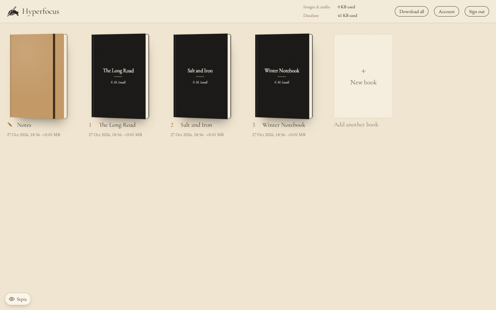
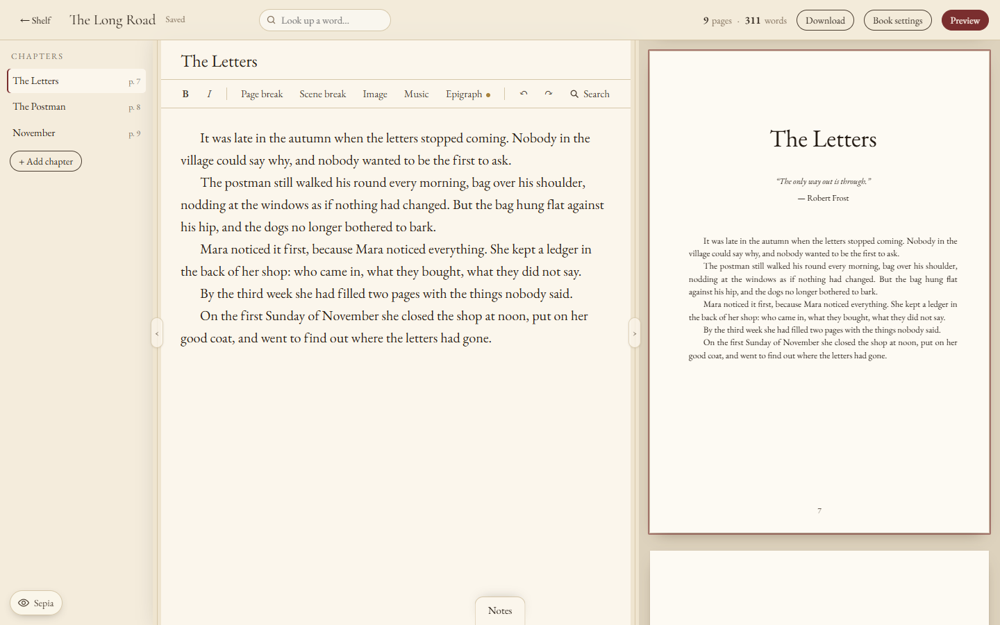
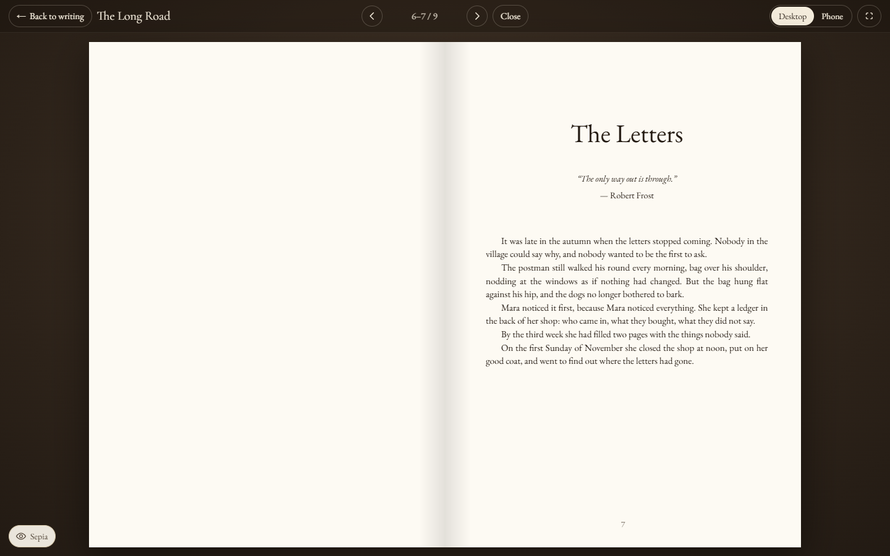
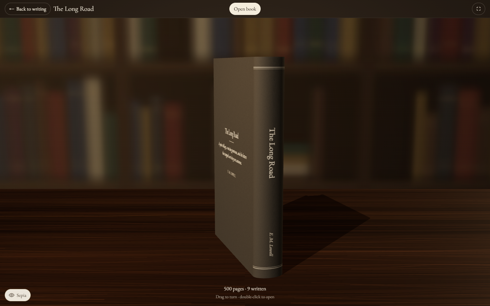
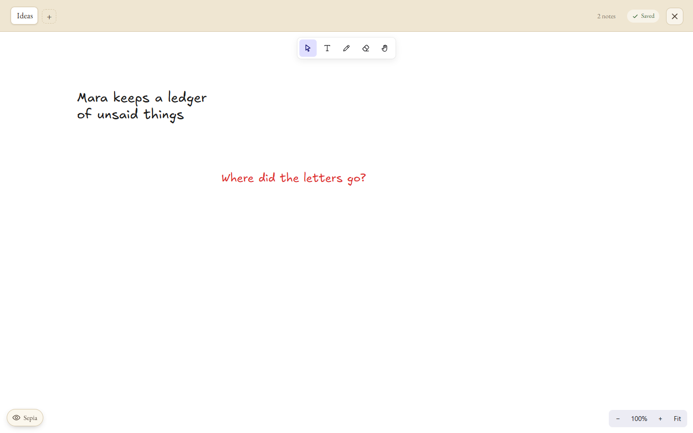

# Hyperfocus

**An interactive book writing/reading tool.**

Write your books in a calm, distraction-free editor: a printed A5 layout with chapter openings, epigraphs, scene breaks and images that text flows around. Read them back as a 3D book on a writer's desk, turn the pages, or export a print-ready PDF and an editable Word file.

I use this tool to write my own novels. You are free to do anything with it.



| Editor with live pages | Reading |
| --- | --- |
|  |  |
| **The 3D book** | **Notes** |
|  |  |

## What it does

- Live A5 pages next to the editor, with epigraphs, scene breaks, images and chapter music
- Find and replace across all chapters and books
- Offline English spell check and dictionary
- A notes board for ideas and sketches
- Export to PDF, Word, or one zip with everything

There is no font or text size choice: every book is set in EB Garamond at fixed sizes, so the pages look the same on screen, in the PDF and in print.

## Run it on your computer

You need [Node.js](https://nodejs.org) 20.12 or newer.

```bash
git clone https://github.com/onattanis/Hyperfocus.git
cd Hyperfocus
npm install
npm run dev
```

Open **http://localhost:5173** and create your account. Your books are saved in `server/data/`.

Forgot your password? Stop the app and run `npm run reset-password`.

## Put it on a website

**Docker:** create a `.env` file with `SETUP_TOKEN=any-secret-code`, then run `docker compose up -d` and open port 3000. You type the setup code once, when you create your account.

**Cloudflare (free):**

```bash
npx wrangler login
npx wrangler d1 create hyperfocus
npx wrangler kv namespace create UPLOADS
# copy the two printed ids into wrangler.toml
npx wrangler pages project create hyperfocus --production-branch main
npx wrangler pages secret put SESSION_SECRET   # any random text, 32+ characters
npx wrangler pages secret put SETUP_TOKEN      # your setup code
npm run deploy:cf
```

**Any Node host:** build with `npm install && npm run build`, start with `npm start`, and set `SETUP_TOKEN` and `DATA_DIR` (a folder on a persistent disk).

More settings are listed in [`server/.env.example`](server/.env.example).

## License

MIT, see [LICENSE](LICENSE). Bundled fonts, dictionaries and WordNet keep their own licenses (in `client/public/`).
